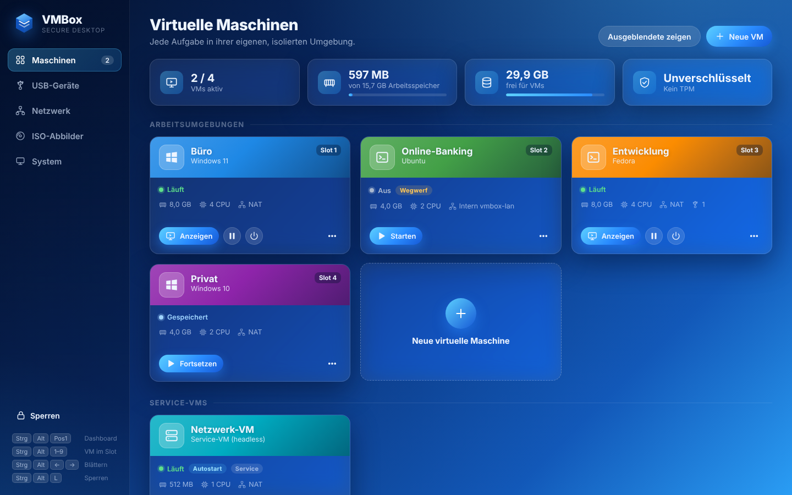
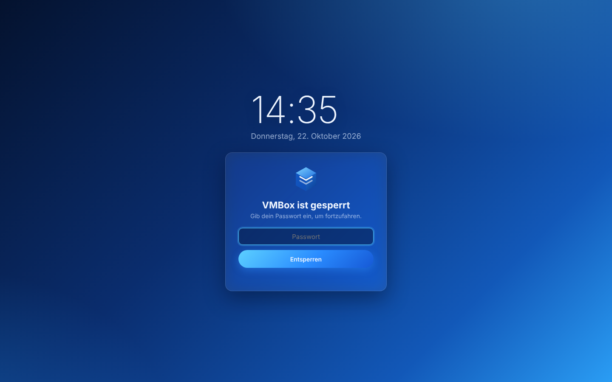
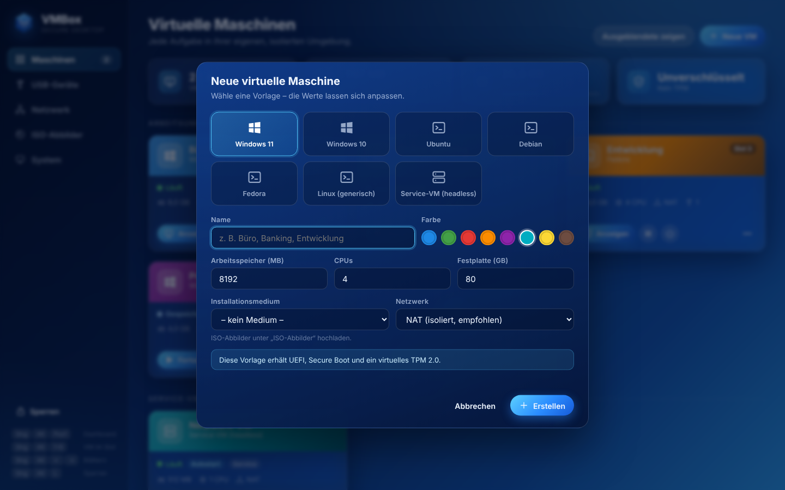
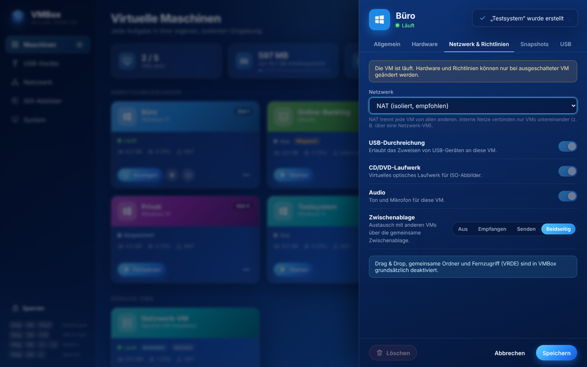

# VMBox – Secure Desktop auf Basis von VirtualBox

VMBox ist eine eigene Linux-Distribution nach dem Vorbild von **OpenXT**:
Der Rechner startet in ein minimales, abgeschottetes Host-System, auf dem
ausschließlich die Verwaltung virtueller Maschinen läuft. Gearbeitet wird
nur **in** den VMs – Büro, Online-Banking, Entwicklung, Privates – jede
strikt von den anderen getrennt. Umgeschaltet wird per Tastenkürzel oder
über die Statusleiste, die immer in der Farbe der aktiven VM leuchtet.

Anders als OpenXT (Xen) nutzt VMBox im Untergrund **Oracle VirtualBox**.
Basis ist Debian 13 „trixie“, gebaut mit `live-build` als Live-/Installer-ISO.



| Sperrbildschirm | Neue VM | Richtlinien |
|---|---|---|
|  |  |  |

Statusleiste über allen VMs (der Streifen unten hat die Farbe der VM, die gerade Tastatur und Bildschirm besitzt):


---

## Funktionsumfang im Vergleich zu OpenXT

| OpenXT | VMBox | Umsetzung |
|---|---|---|
| Xen-Hypervisor | **VirtualBox 7** | Oracle-Pakete, Kernelmodule werden beim ISO-Build für den Image-Kernel gebaut |
| dom0 (minimal, kein Login) | Gehärteter Debian-Host | kein Root-Passwort, keine Shell für den Dienstbenutzer, `nftables` blockiert jeden eingehenden Verkehr, Sysctl-Härtung |
| xenmgr (Toolstack, D-Bus) | **`vmboxd`** | Python-Daemon, JSON-API über `127.0.0.1` (UI) und Unix-Socket (`vmbox-ctl`) |
| `xec` | **`vmbox-ctl`** | Kommandozeile für alle Funktionen |
| UIVM (Verwaltungsoberfläche) | **`vmbox-shell`** | Kiosk-WebKit-Fenster mit Dashboard; keine URL-Leiste, keine fremden Seiten |
| surfman / input server, VM-Switcher | Umschalter in `vmboxd` | VM-Fenster rahmenlos & maximiert, Wechsel per `Strg+Alt+1…9`, `Strg+Alt+←/→`, `Strg+Alt+Pos1` |
| Farbige Sicherheitsanzeige | Statusleiste | Farbstreifen + Name der VM mit Fokus, immer im Vordergrund |
| Benutzer-VMs / Service-VMs | ✓ | Service-VMs laufen headless, sind ausgeblendet und starten automatisch |
| VM-Slots | ✓ | Slot 1–9 je VM, direkt per Tastenkürzel erreichbar |
| USB-Durchreichung mit Richtlinie | ✓ | Zuweisen/Trennen pro Gerät, „Immer zuweisen“ (sticky), Eingabegeräte bleiben beim Host |
| VM-Richtlinien | ✓ | USB, CD/DVD, Audio, Zwischenablage (aus/empfangen/senden/beidseitig) je VM; Drag & Drop, gemeinsame Ordner und VRDE sind immer aus; Richtlinien werden vor jedem Start erneut erzwungen |
| Netzwerk-Isolation, NDVM | ✓ (eingeschränkt) | NAT trennt jede VM von allen anderen; interne Netze (`intnet`) für VM-zu-VM; eine Service-VM kann als Router/Firewall („Netzwerk-VM“) für ein internes Netz dienen |
| Verschlüsselter Speicher, Measured Launch | ✓ (eingeschränkt) | VM-Speicher in LUKS2, optional per TPM 2.0 entsperrt (gebunden an PCR 7 / Secure-Boot-Zustand) |
| Sperrbildschirm / Anmeldung | ✓ | Passwort (PBKDF2), automatische Sperre bei Inaktivität, Sperre per `Strg+Alt+L` |
| Snapshots / Wegwerf-VMs | ✓ | Snapshot-Baum, Wiederherstellen; Wegwerf-Modus = unveränderliches Abbild, Änderungen verschwinden beim Ausschalten |
| Installer | ✓ | Text-Installer (blau), aus dem Live-System oder per Boot-Menü „VMBox installieren“ |

### Ehrliche Grenzen

VirtualBox ist ein **Typ-2-Hypervisor**. Daraus folgen Unterschiede, die sich
nicht wegkonfigurieren lassen:

* **Der Host-Kernel gehört zur vertrauenswürdigen Basis.** Bei Xen ist dom0
  vom Hypervisor getrennt, bei VMBox laufen die VMs als Prozesse auf dem Host.
  VMBox hält den Host deshalb so klein wie möglich (keine Netzwerkdienste,
  kein Login, eine einzige Dienst-Identität).
* **Keine PCI-Durchreichung / Treiber-Domänen.** OpenXT gibt die Netzwerkkarte
  an eine eigene NDVM. VirtualBox kann das nicht mehr; Netzwerkkarte und WLAN
  verwaltet der Host (NetworkManager). Eine „Netzwerk-VM“ ist trotzdem möglich:
  Service-VM mit Brücke nach außen + internem Netz `vmbox-lan`, alle anderen
  VMs hängen nur an `vmbox-lan`.
* **Kein Intel TXT / tboot.** Statt Measured Launch gibt es TPM-gebundene
  Festplattenentsperrung (PCR 7).
* **Secure Boot:** Bootloader und VirtualBox-Kernelmodule sind nicht
  signiert – Secure Boot muss im UEFI-Setup deaktiviert werden.
* Die gemeinsame Zwischenablage verläuft über den Host – eine VM mit
  „Senden“ und eine andere mit „Empfangen“ können so gezielt Daten austauschen.

---

## Installation

1. **ISO besorgen** – entweder aus GitHub Actions (Workflow „VMBox“ → Artefakt
   `vmbox-iso`) oder selbst bauen (siehe unten).
2. **Auf einen USB-Stick schreiben**, z. B.
   `sudo dd if=vmbox-1.0.0-amd64.iso of=/dev/sdX bs=4M status=progress oflag=sync`
3. **Booten.** Im Boot-Menü gibt es:
   * **VMBox Live** – startet direkt in das Dashboard (ideal zum Ausprobieren,
     Änderungen gehen beim Neustart verloren).
   * **VMBox installieren** – startet den Installationsassistenten.
   Im Live-System kann der Installer auch unter *System → VMBox installieren*
   gestartet werden.
4. Der Installer fragt nach Zielfestplatte, Tastaturbelegung, Rechnername,
   Passphrase für die Verschlüsselung, optional TPM-Entsperrung und dem
   Dashboard-Passwort. Danach Neustart – fertig.

Das KVM-Kernelmodul ist in VMBox gesperrt: Es würde VT-x/AMD-V belegen, und
VirtualBox könnte dann keine VM starten („VERR_SVM_IN_USE“/„VERR_VMX_IN_USE“).

**Voraussetzungen:** x86-64-CPU mit VT-x/AMD-V (im BIOS aktiviert),
mindestens 8 GB RAM (16 GB empfohlen), 48 GB Festplatte, UEFI oder BIOS.
Zum Ausprobieren in einer anderen VM muss dort verschachtelte Virtualisierung
(„Nested VT-x/AMD-V“) eingeschaltet sein.

### Festplattenaufteilung

| Partition | Größe | Inhalt |
|---|---|---|
| EFI | 512 MB | Bootloader (UEFI) |
| BIOS-Boot | 1 MB | Bootloader (Legacy) |
| System | 24 GB | VMBox-Host (ext4) |
| Speicher | Rest | **LUKS2** → `/storage` mit allen VMs (`/home/vmbox`), Passwort und ISO-Abbildern (`/var/lib/vmbox`) |

---

## Bedienung

| Tastenkürzel | Funktion |
|---|---|
| `Strg+Alt+Pos1` | zum Dashboard |
| `Strg+Alt+1` … `9` | zur VM im jeweiligen Slot |
| `Strg+Alt+←` / `→` | durch Dashboard und laufende VMs blättern |
| `Strg+Alt+L` | Bildschirm sperren |

* **Neue VM:** Vorlage wählen (Windows 11/10/7/XP/2000, Ubuntu, Debian, Fedora, Linux,
  Service-VM), Name, Farbe, Ressourcen, ISO und Netzwerk festlegen. Windows 11
  bekommt automatisch UEFI, Secure Boot und ein virtuelles TPM 2.0; Windows 7
  bekommt BIOS, USB 2.0 und eine Intel-PRO/1000-Netzwerkkarte, für die es
  eigene Treiber mitbringt.
* **Gasterweiterungen** (Guest Additions) legt der Disc-Knopf an der VM-Karte
  bzw. *Hardware → Gasterweiterungen einlegen* ins virtuelle DVD-Laufwerk ein,
  auch im laufenden Betrieb (`vmbox-ctl guest-additions <vm>`). Danach im Gast
  `VBoxWindowsAdditions.exe` bzw. `VBoxLinuxAdditions.run` starten.
* **Windows XP und 2000** bekommen zeitgemäße Hardware, für die sie Treiber
  mitbringen: IDE-Controller, PCnet-FAST-III-Netzwerkkarte, AC'97-Ton,
  PS/2-Maus und VBoxVGA (ohne 3D). Weil es keine Sicherheitsupdates mehr gibt,
  starten sie ohne Netzwerk; bei Bedarf am besten nur an ein internes Netz
  hängen. Die aktuellen Gasterweiterungen unterstützen diese Systeme teils
  nicht mehr – dann eine ältere Version der Gasterweiterungen verwenden.
* **3D-Beschleunigung** ist bei allen Arbeits-VMs eingeschaltet (VBoxSVGA bzw.
  VMSVGA, 256 MB Grafikspeicher bei Windows) und lässt sich unter
  *Hardware* abschalten. Sie wirkt erst, wenn im Gast die VirtualBox-
  Gasterweiterungen installiert sind (bei Windows 7 nötig für Aero). Auf dem
  Host nutzt VirtualBox dafür Mesa (OpenGL/Vulkan); proprietäre
  NVIDIA-Treiber sind nicht im Image.
* **ISO-Abbilder** kommen per **USB-Stick** in die Bibliothek: Stick einstecken,
  unter *ISO-Abbilder → Von USB-Stick importieren* „ISO-Dateien anzeigen“,
  „Importieren“, danach „Auswerfen“. Unterstützt werden exFAT, NTFS, FAT32,
  ext2/3/4, Btrfs, XFS, ISO 9660 und UDF. Der Host bindet Sticks nie von sich
  aus ein, sondern erst auf Klick – schreibgeschützt und ohne Ausführrechte;
  der VMBox-Boot-Stick und interne Festplatten werden nicht angeboten.
* **VM-Einstellungen** (⋯ an der Karte): Allgemein, Hardware, Netzwerk &
  Richtlinien, Snapshots, USB.
* **Beenden** einer VM: Herunterfahren (ACPI), Zustand speichern oder
  Ausschalten erzwingen.
* Beim Herunterfahren des Hosts werden laufende VMs gespeichert und nach der
  nächsten Anmeldung automatisch fortgesetzt.

### `vmbox-ctl`

```text
vmbox-ctl list [--json]                 VMs auflisten
vmbox-ctl info <vm>                     Details (Name, Slot oder UUID)
vmbox-ctl start|shutdown|poweroff|pause|resume|reboot|save <vm>
vmbox-ctl guest-additions <vm>          Gasterweiterungen einlegen
vmbox-ctl switch ui|next|prev|<vm>      Anzeige umschalten
vmbox-ctl switch slot <n>
vmbox-ctl lock                          Bildschirm sperren
vmbox-ctl save-all                      alle laufenden VMs speichern
vmbox-ctl usb list | assign <gerät> <vm> [--force] | release <gerät>
vmbox-ctl snapshot list|take|restore|delete <vm> [name]
```

---

## Architektur

```text
┌──────────────────────────── Bildschirm (X11, VT1) ────────────────────────────┐
│ Statusleiste (vmbox-shell, Dock)   ● Büro 1  ● Entwicklung 3      🔒  14:22   │
├───────────────────────────────────────────────────────────────────────────────┤
│  Dashboard (vmbox-shell, WebKit)   oder   VM-Fenster (VirtualBoxVM --separate)│
└───────────────────────────────────────────────────────────────────────────────┘
        │ HTTP 127.0.0.1:8470 (Session-Cookie)      ▲ Openbox-Tastenkürzel
        ▼                                           │ vmbox-ctl ── Unix-Socket
┌──────────────────────────── vmboxd (Benutzer „vmbox“) ────────────────────────┐
│ Toolstack · Richtlinien · USB · Umschalten · Sperre · Autostart · ISO-Ablage  │
└───────────────────────────────────┬───────────────────────────────────────────┘
                                    │ VBoxManage
┌───────────────────────────────────▼───────────────────────────────────────────┐
│ VirtualBox (VBoxSVC, VBoxHeadless je VM)   ·   vboxdrv / vboxnetflt / vboxnetadp│
└───────────────────────────────────────────────────────────────────────────────┘
  Debian 13 · systemd · nftables (alles eingehende verworfen) · LUKS2/TPM2 · NetworkManager
```

* Jede VM läuft als eigener `VBoxHeadless`-Prozess; das Fenster ist nur ein
  abtrennbares Frontend (`--type separate`). Stürzt die Oberfläche ab, laufen
  die VMs weiter und `vmboxd` hängt die Fenster automatisch wieder an.
* VMBox-spezifische Daten (Farbe, Slot, Richtlinien, …) stehen als
  VirtualBox-*extradata* unter `VMBox/` direkt in der VM-Konfiguration.
* Die API prüft `Host`- und `Origin`-Header (Schutz gegen DNS-Rebinding und
  CSRF), NAT-Gäste können den Host nicht erreichen (`--nat-localhostreachable off`).

### Projektstruktur

```text
src/vmboxd/        Toolstack-Daemon (Python, nur Standardbibliothek)
src/ui/            Dashboard, Statusleiste, Sperrbildschirm (HTML/CSS/JS)
src/bin/           vmbox-ctl, vmbox-shell, vmbox-session, vmbox-xstart, vmbox-installer
src/systemd/       systemd-Units
src/etc/           Firewall, polkit, Xorg, sysctl, VMBox-Konfiguration
src/share/         Openbox-Konfiguration (nur VMBox-Tastenkürzel)
live/              live-build-Konfiguration (Paketliste, Hooks, Boot-Menü)
artwork/           Boot-Grafiken (erzeugt mit tools/make-artwork.py)
tests/             Unit- und API-Tests
```

---

## Entwicklung

```bash
make demo   # Dashboard ohne VirtualBox ausprobieren → http://127.0.0.1:8470
make test   # Unit- und API-Tests (simuliertes VBoxManage)
make lint   # pyflakes, shellcheck, node --check
```

Der Demo-Modus (`--demo`) simuliert VirtualBox mit Beispiel-VMs und
USB-Geräten – damit lässt sich die gesamte Oberfläche im Browser bedienen.

### ISO selbst bauen

Auf einem Debian-System (oder in einem privilegierten `debian:trixie`-Container):

```bash
sudo apt install live-build gnupg curl make
sudo ./build.sh                         # → out/vmbox-1.0.0-amd64.iso
VBOX_PACKAGE=virtualbox-7.1 sudo -E ./build.sh   # bestimmte VirtualBox-Version
```

Der Build lädt den Oracle-Signaturschlüssel, prüft dessen Fingerabdruck
(`B9F8 D658 297A F3EF C18D 5CDF A2F6 83C5 2980 AECF`), installiert VirtualBox
aus dem Oracle-Repository und kompiliert die Kernelmodule für den Kernel des
Images. GitHub Actions baut das ISO bei jedem Push automatisch.

### Secure Boot

Version 1.0 bootet ohne Secure Boot: Weder der Bootloader (kein `shim`) noch
die selbst gebauten VirtualBox-Module sind signiert. Secure Boot daher im
UEFI-Setup deaktivieren. Die TPM-Entsperrung funktioniert trotzdem – sie ist
an den Secure-Boot-*Zustand* (PCR 7) gebunden, nicht an Secure Boot selbst.
